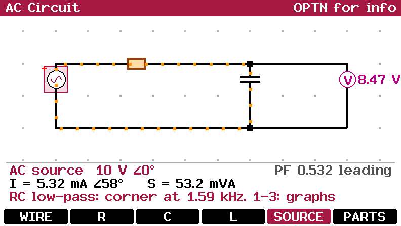
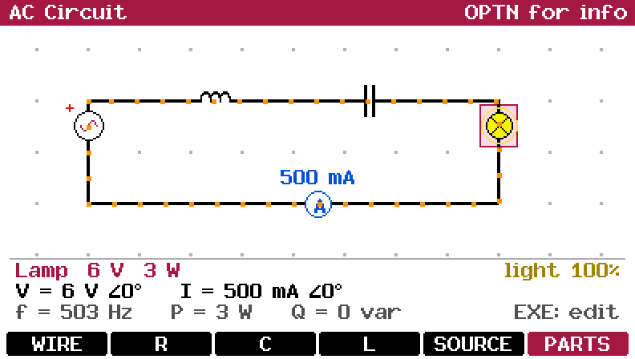
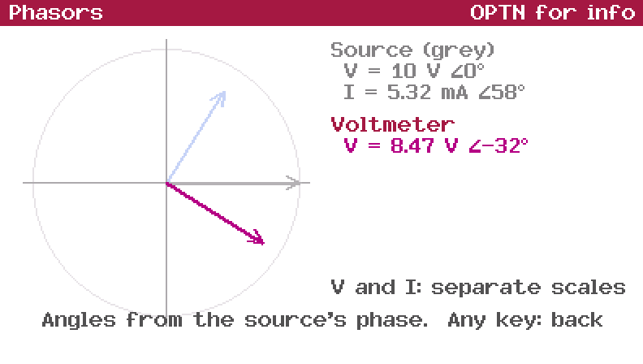
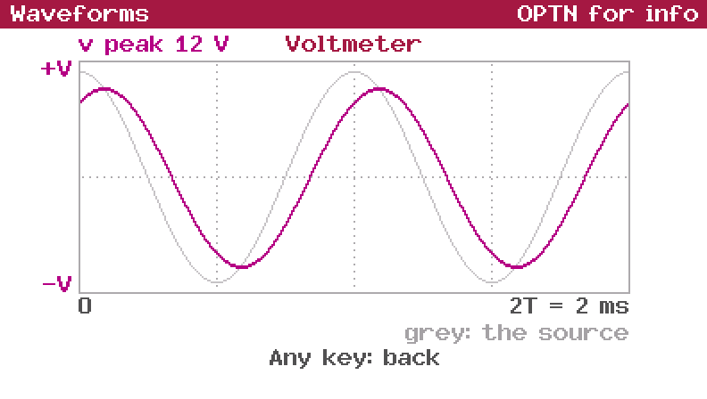
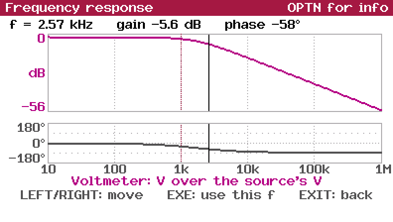
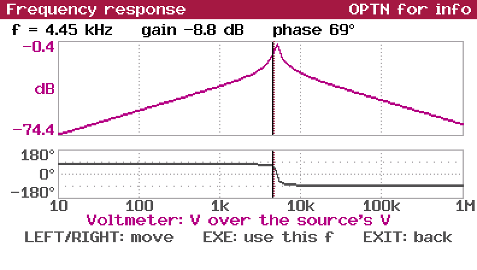
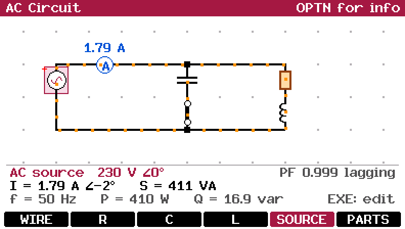
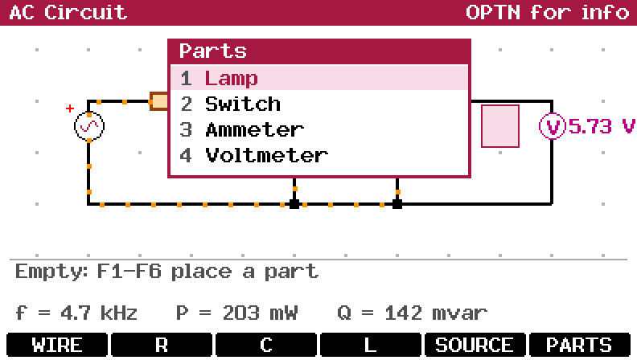

AC circuit simulator for the Casio FX CG 50 (works with the CG10 and 20 too). Made with fxSDK and gint.

## Download

| Calculator | File |
|---|---|
| fx-CG50, fx-CG10, fx-CG20 (colour) | [ACCircuit.g3a](../../dist/g3a/ACCircuit.g3a) |

Copy the file to the root of the calculator's storage over USB (USB Flash mode, F1), then eject it; the app appears in the MENU. This app needs the colour screen, so there is no black and white version.

The AC companion to [Circuit](../circuit). Build a circuit of resistors,
capacitors and inductors on the same 12 × 5 grid and read every part's
voltage and current as a phasor: size (rms, what a meter shows) and phase.
Every source runs at the circuit's one frequency, and the circuit is solved
again after every change. The dots on the wires swing back and forth with the
current, so branches that are out of phase swing at different times.

 

| Part | Behaviour | Default |
|---|---|---|
| Wire | No impedance | |
| Resistor | Z = R | 100 Ω |
| Capacitor | Z = 1 / (jωC) | 10 µF |
| Inductor | Z = R + jωL, with its wire's resistance (at least 1 mΩ) | 10 mH |
| AC source | Ideal: rms voltage and phase; + marks its phase reference | 10 V, 0° |
| Lamp | Resistor of V²/P ohms; glows by its power, OVERLOAD above 120% | 6 V, 3 W |
| Switch | Open or closed | closed |
| Ammeter | No impedance; shows the rms current next to it | |
| Voltmeter | Infinite impedance; shows the rms voltage next to it | |

Parts sit on the links between two grid points. Move the cursor over a link
to place or read a part, or over a point to read its voltage (from the first
source's − terminal).

| Key | Action |
|---|---|
| Arrows | Move the cursor (links and points) |
| F1 | Wire. On a point: draw wires with the arrows, EXE or EXIT to stop |
| F2 / F3 / F4 | Resistor / capacitor / inductor |
| F5 | AC source; again on a source to turn it around |
| F6 | Parts menu: lamp, switch, ammeter, voltmeter |
| DEL | Delete the part |
| EXE | Edit the part's values (or open/close a switch) |
| + / − | Frequency up / down along the E12 series (1, 1.2, 1.5 … 8.2) |
| X,θ,T | Type the frequency (1 Hz to 1 MHz) |
| 1 / 2 / 3 | Phasors / waveforms / frequency response of the part at the cursor (or of the source) |
| VARS | Load an example |
| AC twice | Clear the whole circuit |

The bottom lines show the part and its values (with its impedance at this
frequency), its V and I phasors, then the frequency and the real (P, W) and
reactive (Q, var) power of the part, or of the whole circuit. On a source
they show its current, apparent power (S, VA) and power factor, leading or
lagging. In the edit screen, F1–F6 add an SI prefix (p n µ m k M), and the
reactance at the current frequency is shown as you type.

## Graphs

| Key | Graph |
|---|---|
| 1 | **Phasors**: V and I of the part as arrows (each to its own scale), the source's in grey, with the impedance and whether I leads or lags V |
| 2 | **Waveforms**: v(t) and i(t) over two periods, with the source's voltage in grey and the peak values |
| 3 | **Frequency response**: the part's voltage over the source's (in dB), or the current for wires, ammeters and sources, and the phase, over five decades around the frequency. LEFT/RIGHT read it point by point, EXE makes the frequency at the cursor the circuit's |

 
 

## Examples

VARS loads them one after another:

| Example | Try |
|---|---|
| RC low-pass (1 kΩ, 100 nF, corner at 1.59 kHz) | 3 on the voltmeter: −3 dB and −45° at the corner |
| Series RLC with a lamp (12 Ω, 10 mH, 10 µF) | + / − : the lamp is brightest at 503 Hz, where the source sees only the lamp |
| RL load on 230 V 50 Hz (power factor 0.62) | Close the switch: the 30 µF capacitor brings it to 0.999 and the current from 2.86 A to 1.79 A |
| Parallel LC tank (1 mH, 1 µF) fed through 330 Ω | 3 on the voltmeter: the voltage peaks at 5.03 kHz |
| RC high-pass (100 nF, 1 kΩ) | 3 on the voltmeter |

 

The solver uses nodal analysis with complex numbers, as Circuit does with
real ones. Points joined by wires, ammeters or closed switches become one
node, each source adds an equation for its current, and the current in each
wire is worked out from how it splits between the parts. A source whose
terminals are wired together is a short circuit, and sources in parallel or
in a loop have no solution; both are shown instead of the readings. The
inductor's minimum 1 mΩ keeps a series LC across a source solvable at
resonance, with a very large current.

The circuit and its frequency are saved to `\\fls0\ACCircuit.acc` on exit
and reopened next time.

OPTN opens the info screen and EXIT quits.

© José Rodrigues 2026
