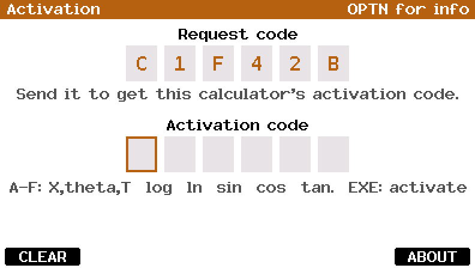
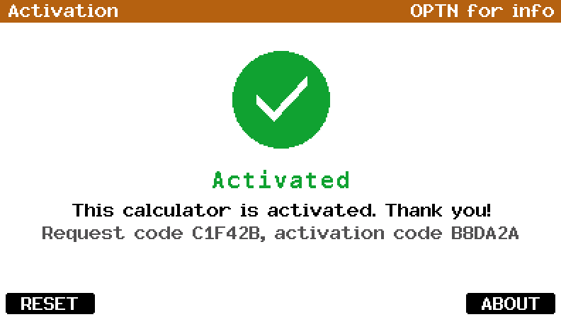

# Activation

A product-activation demo for the Casio FX CG 50 (works with the CG10 and 20 too). Made with fxSDK and gint.

## Download

| Calculator | File |
|---|---|
| fx-CG50, fx-CG10, fx-CG20 (colour) | [Activation.g3a](../../dist/g3a/Activation.g3a) |

Copy the file to the root of the calculator's storage over USB (USB Flash mode, F1), then eject it; the app appears in the MENU. This app needs the colour screen, so there is no black and white version.

| | |
|:---:|:---:|
| <br>Request code | <br>Activated |

## How it works

1. The add-in shows a **request code**: 6 hex characters from a salted hash
   of the calculator's product ID (8 bytes of ROM at `0x8001FFD0`). It is
   the same every time on one calculator and different on another.
2. Whoever hands out activations turns it into the **activation code** with
   the key generator, a hash of the request code with a second salt:

   ```
   apps/activation/tools/keygen.py C1F42B
   B8DA2A
   ```

   `keygen.py --id 0123456789ABCDEF` gives both codes from a product ID
   (in emuCasioCalc: Emulation > Product ID, or `--device-id`).
3. Typing the activation code and pressing EXE shows the **Activated**
   screen. The code is kept in `Activ.key` in the storage memory and checked
   again at start-up, so the add-in stays activated, but not on a
   calculator the file is copied to.

Both hashes (FNV-1a, then MurmurHash3's finaliser, top 24 bits) and their
salts are in `src/main.c` and `tools/keygen.py`, which must match. This is
a demo: the salts are public in this repository, so it keeps no one out.

| Key | Action |
|---|---|
| 0–9, X,θ,T log ln sin cos tan | Type a character (A–F on the red-letter keys) |
| DEL | Delete the last character |
| F1 or AC/ON | Clear the code (F1 on the Activated screen: deactivate) |
| EXE | Check the code |
| OPTN or F6 | Info screen |
| EXIT | Quit |

© José Rodrigues 2026
