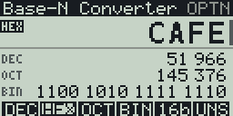
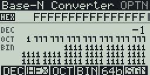

This is a BaseN converter for the Casio FX CG 50 (works with the CG10 and 20 too), with a black and white version for the fx-9860G II. Made with fxSDK and gint.

## Download

| Calculator | File |
|---|---|
| fx-CG50, fx-CG10, fx-CG20 (colour) | [Base-N.g3a](../../dist/g3a/Base-N.g3a) |
| fx-9860G II, fx-9750G II, Graph 35+E II (black and white) | [Base-N.g1a](../../dist/g1a/Base-N.g1a) |

Copy the file to the root of the calculator's storage over USB (USB Flash mode, F1), then eject it; the app appears in the MENU.

Programmer-calculator layout: the number you type is shown large, with live
DEC / HEX / OCT / BIN conversions and a 64-bit grid of its bits below.

| Key | Action |
|---|---|
| F1–F4, ▲/▼ | Input base (DEC, HEX, OCT, BIN); the value is kept |
| 0–9, X,θ,T / log / ln / sin / cos / tan | Digits (A–F are the six keys of the second row) |
| DEL | Delete the last digit |
| AC/ON | Clear |
| (−) | Negate (two's complement) |
| F5 | Word size: 8 / 16 / 32 / 64 bits |
| F6 | Signed: decimal shows the two's complement value |
| OPTN | Info screen (author, QR code to the GitHub repo) |
| EXIT | Quit |

## fx-9860G (128x64)

`Base-N.g1a` is the same converter for the black-and-white fx-9860G, with
the same keys. What differs on the small screen:

- No bit grid and no status line. The word size shows on F5 (`8b`, `16b`,
  `32b`, `64b`) and the sign mode on F6 (`UNS` or `SGN`, grey when signed).
  The input base has a grey F-key and a white-on-black label.
- The value being typed is at the top, large while it fits; below it are the
  three conversions, each with a small 3-letter label.
- Long values use a small 3x5 font, and binary wraps every six nibbles
  (64 bits take three lines). The layout uses the largest fonts that fit.
- The info screen is text only (no QR code), and all text is in English.

The large font and the info screen's QR code are shared by every app; see
`common/` in the repository README.

© José Rodrigues 2026
