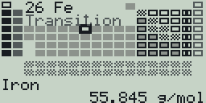
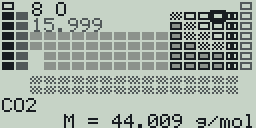
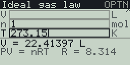

Chemistry toolkit and unit converter for the Casio FX CG 50 (works with the CG10 and 20 too), with a black and white version for the fx-9860G II. Made with fxSDK and gint.

## Download

| Calculator | File |
|---|---|
| fx-CG50, fx-CG10, fx-CG20 (colour) | [Chemistry.g3a](../../dist/g3a/Chemistry.g3a) |
| fx-9860G II, fx-9750G II, Graph 35+E II (black and white) | [Chemistry.g1a](../../dist/g1a/Chemistry.g1a) |

Copy the file to the root of the calculator's storage over USB (USB Flash mode, F1), then eject it; the app appears in the MENU.

Pick a tool from the menu with the number keys or ▲/▼ + EXE:

| # | Tool | What it does |
|---|---|---|
| 1 | Unit converter | Length, area, volume, mass, temperature, pressure, energy, time, speed and data. Type a value and read every unit at once (e.g. dm3 -> cm3) |
| 2 | Molar mass | Build a formula from the periodic table and get its molar mass |
| 3 | Mole calculator | n <-> particles (Avogadro), mass (with molar mass) and gas volume at STP |
| 4 | Concentration | c = n / V; leave one field empty to solve for it |
| 5 | Ideal gas law | P V = n R T (P in kPa, V in L, T in K); leave one field empty to solve for it |
| 6 | Periodic table | Browse all 118 elements: symbol, number, atomic weight and category |

## Unit converter

| Key | Action |
|---|---|
| ◀ / ▶ | Change category |
| ▲ / ▼ | Change the input unit |
| 0-9, ., ×10^x, (−) | Type the value |
| DEL / AC | Delete / clear |

## Molar mass

A periodic table is shown; navigate it with the arrows.

| Key | Action |
|---|---|
| ▲▼◀▶ | Move the element cursor |
| EXE | Add the highlighted element (again to increase its count) |
| 0-9 | Set the last element's subscript |
| DEL / AC | Remove the last element / clear |

## Mole, concentration and gas screens

Type into the fields; ▲/▼ or EXE move between them. On the concentration and
gas screens, leave exactly one field empty and its value is solved from the
others.

## fx-9860G (128x64)

`Chemistry.g1a` has the same tools and keys on the black-and-white
fx-9860G. What differs on the small screen:

- The periodic table fills the screen (no title bar): 7x5-pixel cells
  without symbols, the categories shown as grey shades and patterns, and the
  cursor as a thick black frame. The highlighted element's number, symbol
  and category are in the gap above the transition metals; its name and
  weight are below the table.
- Molar mass uses the same table. The gap shows the highlighted element and
  its weight; below the table are the formula (its end, after `<`, when it
  is too long) and `M = ... g/mol`. The key hints show while the formula is
  empty.
- Forms show 3 fields at a time (the gas law scrolls) and compact result
  lines; the molar-mass field of the mole calculator is just `M`.
- The info screen (OPTN) is text only.

Language (English / Portuguese) follows the calculator's system language.

© José Rodrigues 2026
