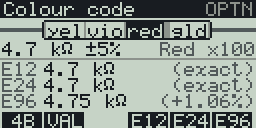
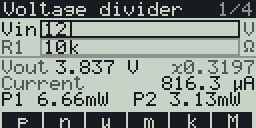

This is an electronics toolkit for the Casio FX CG 50 (works with the CG10 and 20 too), with a black and white version for the fx-9860G II. Made with fxSDK and gint.

## Download

| Calculator | File |
|---|---|
| fx-CG50, fx-CG10, fx-CG20 (colour) | [Electronics.g3a](../../dist/g3a/Electronics.g3a) |
| fx-9860G II, fx-9750G II, Graph 35+E II (black and white) | [Electronics.g1a](../../dist/g1a/Electronics.g1a) |

Copy the file to the root of the calculator's storage over USB (USB Flash mode, F1), then eject it; the app appears in the MENU.

Pick a tool from the menu with ▲/▼ and EXE, or its number key:

| # | Tool | What it does |
|---|---|---|
| 1 | Colour code | Draws the resistor in real colours from 3 to 6 bands: value, tolerance, range, tempco, nearest E12/E24/E96. Also works in reverse, from a value to its bands |
| 2 | SMD codes | Decodes 3-digit (`472`), 4-digit (`4702`), `R` (`4R7`) and EIA-96 (`01C`) codes, and gives every code for a value |
| 3 | Series / parallel | Up to 8 resistors; series and parallel totals with the nearest E24 value |
| 4 | Voltage divider | Vout, current, power in each resistor; R2 for a target Vout, with E12/E24 values |
| 5 | RC / RL filters | RC and RL cutoff and time constant, LC resonance, series RLC Q |
| 6 | 555 timer | Astable frequency, period, high/low times, duty cycle; monostable pulse width |
| 7 | LED resistor | Series resistor for one or more LEDs, its power and rating, E12/E24 values rounded up |

## Colour code

| Key | Action |
|---|---|
| ◀ / ▶ | Select a band |
| ▲ / ▼ | Change its colour |
| 0–9 | Set a digit or multiplier band directly |
| F1 | Number of bands: 3 / 4 / 5 / 6 |
| F2 or EXE | Type a value and get its bands |
| F4 / F5 / F6 | Snap to the nearest E12 / E24 / E96 value |

## Forms (tools 2–7)

Results update as you type.

| Key | Action |
|---|---|
| ▲ / ▼, EXE | Move between fields (◀ / ▶ change columns in Series / parallel) |
| 0–9, `.`, ×10^x, (−) | Type a number (`1E-6`) |
| F1–F6 | SI prefix: p n µ m k M; `4k7` means 4.7k |
| ◀ / ▶ | Change a choice field (555 mode, LED colour, EIA-96 letter) |
| `.` | In an SMD code, types `R` |
| DEL / AC | Delete a character / clear the field |

OPTN opens the info screen and EXIT goes back (to the menu, then out of the add-in).

## fx-9860G (128x64)
`Electronics.g1a` has the same seven tools and keys on the black-and-white
fx-9860G. What differs on the small screen:

- Colour code: four greys cannot show the colours, so each band is a
  3-letter name (`yel vio red gld`) on a drawn resistor body, the selected
  band in white on black. Below are the value and tolerance, the selected
  band's colour and meaning (`Red ×100`), and the nearest E12, E24 and E96
  values. The range and the 6-band tempco line are left out (select the
  tempco band to see it). F1 shows `4B` for 4 bands. A value that the bands
  cannot show exactly is shown as `Typed 4.75 kΩ` in place of the E96 line.
- Forms show two fields at a time (they scroll, with an `n/N` mark) and
  three short result lines; labels are shortened (`Vt` for the target Vout,
  `Vs` / `Vf` / `I` in LED resistor). The voltage divider shows R2 for the
  target only while the target field is selected. Left out: the help lines
  and formulas, the LED power, the deviations of the E24/E96 values in SMD
  codes, and the LC Z0 when R is set (the RLC Q is shown in its place).
- The info screen is text only (no QR code), and all text is in English.

© José Rodrigues 2026
