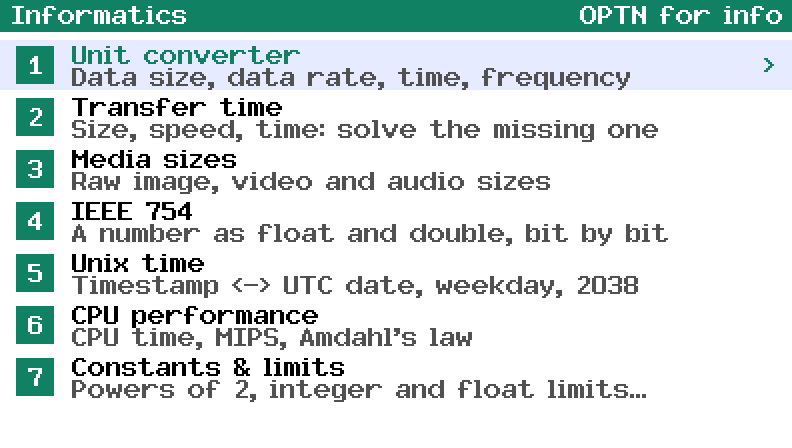
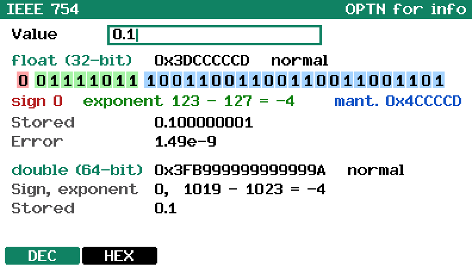
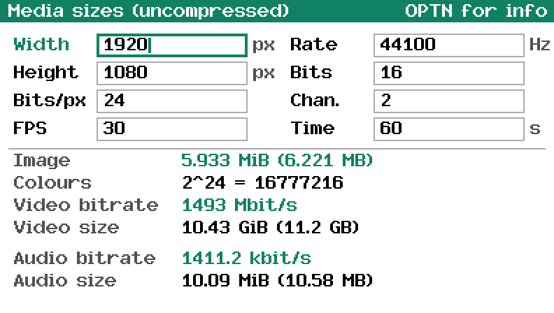
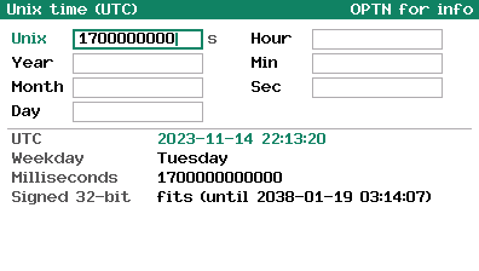
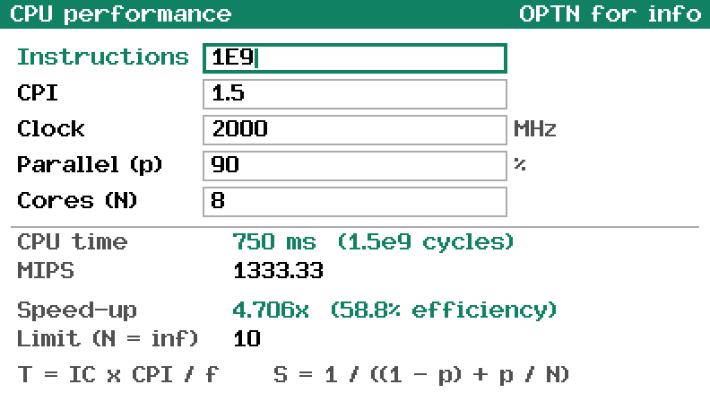
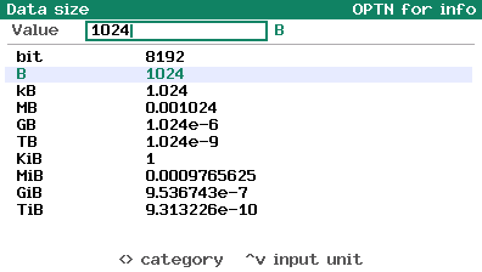

Informatics toolkit for the Casio FX CG 50 (works with the CG10 and 20 too): data conversions, calculations and constants for computing classes. Made with fxSDK and gint.

## Download

| Calculator | File |
|---|---|
| fx-CG50, fx-CG10, fx-CG20 (colour) | [Informatics.g3a](../../dist/g3a/Informatics.g3a) |

Copy the file to the root of the calculator's storage over USB (USB Flash mode, F1), then eject it; the app appears in the MENU. There is no black and white version yet.

| | |
|:---:|:---:|
|  Menu |  IEEE 754 |
|  Media sizes |  Unix time |
|  CPU performance |  Unit converter |

Pick a tool from the menu with the number keys or ▲/▼ + EXE:

| # | Tool | What it does |
|---|---|---|
| 1 | Unit converter | Data size (bit, B, kB…TB, KiB…TiB), data rate (bit/s…Gbit/s, B/s…GB/s, KiB/s, MiB/s), time (ns to years), frequency |
| 2 | Transfer time | Size (MB), speed (Mbit/s) and time: leave one empty and it is solved; shows the time as h/min/s, the size in MiB and the speed in MB/s |
| 3 | Media sizes | Uncompressed image (width × height × bits per pixel, number of colours), raw video bitrate and size (× FPS × time), PCM audio bitrate and size (rate × bits × channels × time) |
| 4 | IEEE 754 | A number as a float (32-bit): its hex, its 32 bits coloured as sign / exponent / mantissa, the exponent with its bias, the value actually stored and the rounding error; and as a double (64-bit). F2 types the float's bits in hex instead, F1 goes back to decimal |
| 5 | Unix time | A timestamp to a UTC date and time, weekday and milliseconds, and whether it fits in signed 32 bits (the year 2038 problem); leave the timestamp empty to turn a date into one |
| 6 | CPU performance | CPU time = instructions × CPI ÷ clock, cycles, MIPS; Amdahl's law: speed-up and efficiency with N cores for a parallel fraction p, and the limit as N grows |
| 7 | Constants & limits | Powers of 2, integer type ranges (8 to 64 bits), float and double limits and epsilons, the Unix epoch and 2038, Ethernet MTU, IPv4 / IPv6 / TCP / UDP header sizes, light in optical fibre |

The decimal units are powers of 1000 (1 MB = 10⁶ bytes) and the binary ones
powers of 1024 (1 MiB = 2²⁰ bytes).

| Key | Action |
|---|---|
| 0-9, ., ×10^x, (−) | Type a number |
| X,θ,T log ln sin cos tan | A–F, in the IEEE 754 screen's hex mode |
| ▲ ▼ / EXE | Move between fields (◀ ▶ switch columns) |
| ◀ ▶ | Unit converter: change the category |
| DEL / AC | Delete a digit / clear the field |
| OPTN | Info screen |
| EXIT | Back / quit |

Language (English / Portuguese / French) follows the calculator's system
language.

© José Rodrigues 2026
