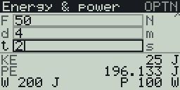
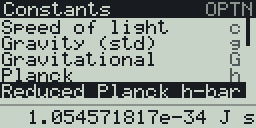

Physics toolkit for the Casio FX CG 50 (works with the CG10 and 20 too), with a black and white version for the fx-9860G II. Made with fxSDK and gint.

## Download

| Calculator | File |
|---|---|
| fx-CG50, fx-CG10, fx-CG20 (colour) | [Physics.g3a](../../dist/g3a/Physics.g3a) |
| fx-9860G II, fx-9750G II, Graph 35+E II (black and white) | [Physics.g1a](../../dist/g1a/Physics.g1a) |

Copy the file to the root of the calculator's storage over USB (USB Flash mode, F1), then eject it; the app appears in the MENU.

Pick a tool from the menu with the number keys or ▲/▼ + EXE:

| # | Tool | What it does |
|---|---|---|
| 1 | Unit converter | Length, area, volume, mass, temperature, pressure, energy, time, speed, data |
| 2 | Kinematics | SUVAT: enter any 3 of s, u, v, a, t and the rest are solved |
| 3 | Dynamics | F = ma, weight W = mg, momentum p = mv |
| 4 | Energy & power | KE = ½mv², PE = mgh, work W = Fd, power P = W/t |
| 5 | Waves & optics | wave speed v = fλ, period T = 1/f, Snell's law |
| 6 | Constants | c, g, G, h, e, mₑ, mₚ, Nₐ, k_B, R, ε₀, µ₀ and more |

## Entering values

Type into the fields; ▲/▼ or EXE move between them (◀/▶ switch columns on the
Energy screen). Leave a field empty to mean "unknown". Kinematics solves the
remaining values once any three are given; the other screens show every
quantity they can compute from what you entered.

| Key | Action |
|---|---|
| 0-9, ., ×10^x, (−) | Type a number |
| DEL / AC | Delete a digit / clear the field |
| OPTN | Info screen |
| EXIT | Back / quit |

Angles for Snell's law are in degrees. Language (English / Portuguese /
French) follows the calculator's system language.

## fx-9860G (128x64)

`Physics.g1a` is the same app on the 128x64 black-and-white fx-9860G (4 grey
shades). The keys are the same; what differs:

- The fields are in one column and 3 are shown at a time; the list scrolls
  as ▲/▼/EXE move through it (◀/▶ do nothing on the Energy screen).
- Results take the 3 lines below the fields: the label at the left, the
  value and unit against the right edge, with fewer digits when a long value
  would not fit.
- Kinematics is titled just "Kinematics".
- Dynamics drops the formula footer and the "g = ..." line (g is the 4th
  field, 9.80665 m/s² when empty).
- Energy & power lists only the results it can compute; when all four can,
  work and power share the last line (`W 200 J  P 100 W`, without the units
  if the numbers are long).
- Waves & optics drops the Snell's law header: the refraction angle is the
  3rd line, "Snell O2".
- Constants shows 5 constants at a time with short names and their symbols,
  and the selected one's value and unit on the bottom line.
- The fx-9860G add-in is in English only.

 

© José Rodrigues 2026
