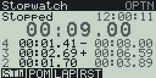
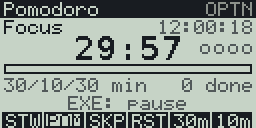

Stopwatch and Pomodoro timer for the Casio FX CG 50 (works with the CG10 and 20 too), with a black and white version for the fx-9860G II. Made with fxSDK and gint.

## Download

| Calculator | File |
|---|---|
| fx-CG50, fx-CG10, fx-CG20 (colour) | [Timer.g3a](../../dist/g3a/Timer.g3a) |
| fx-9860G II, fx-9750G II, Graph 35+E II (black and white) | [Timer.g1a](../../dist/g1a/Timer.g1a) |

Copy the file to the root of the calculator's storage over USB (USB Flash mode, F1), then eject it; the app appears in the MENU.

The time is shown in large digits (the shared big font scaled up) and driven
by the calculator's real-time clock, so it keeps correct time while running.
The current date and time are shown in the top-right. Switch mode with F1/F2.

## Stopwatch (F1)

| Key | Action |
|---|---|
| EXE | Start / stop |
| F3 | Lap (the fastest and slowest laps are coloured) |
| F4 or AC | Reset |

## Pomodoro (F2)

Focus / short break / long break cycle. After four focus sessions the next
break is a long one. A progress bar and session dots show where you are, and
the screen flashes "Time's up!" when a phase ends.

| Key | Action |
|---|---|
| EXE | Start / pause |
| F3 | Skip to the next phase |
| F4 or AC | Reset the current phase |
| F5 | Focus length (15–60 min) |
| F6 | Break length (short; the long break is 3×) |

OPTN opens the info screen and EXIT quits.

## fx-9860G

`Timer.g1a` is the same app on the 128x64 black-and-white fx-9860G (4 grey
shades). The keys are the same; what differs:

- The F-key labels are abbreviated: STW (stopwatch), POM, LAP, RST (reset),
  SKP (skip), and the lengths as `25m` / `5m`.
- The clock shows only the time (no weekday or date), and the large digits
  are the big font at its normal size.
- The stopwatch lists the last 3 laps (5 on the fx-CG), without a header:
  lap number, lap time, total. The fastest lap is marked `-` and the
  slowest `+` instead of being coloured.
- The on-screen hint shows only the EXE action; the F-keys label the rest.
- Pomodoro phases are told apart by name only (no phase colours). The
  "Time's up!" band reads "EXE: <next phase>".

 

© José Rodrigues 2026
