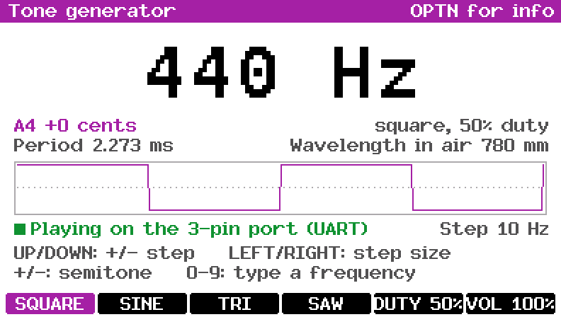
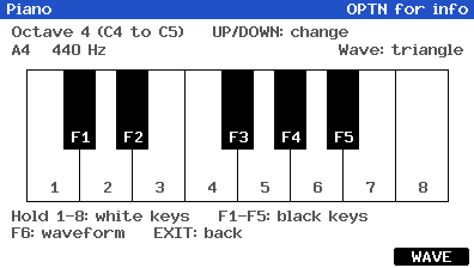
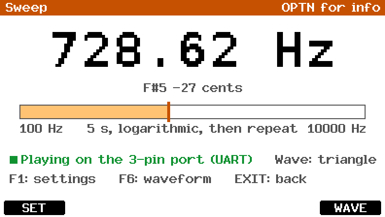
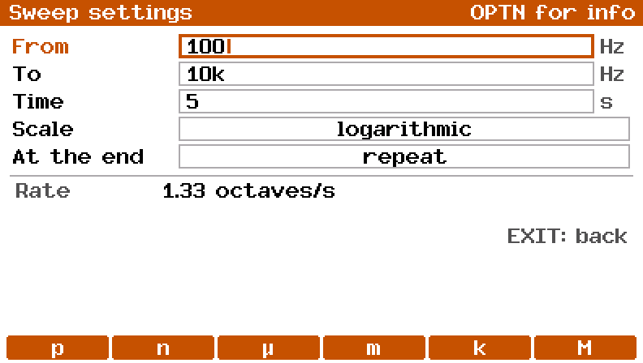
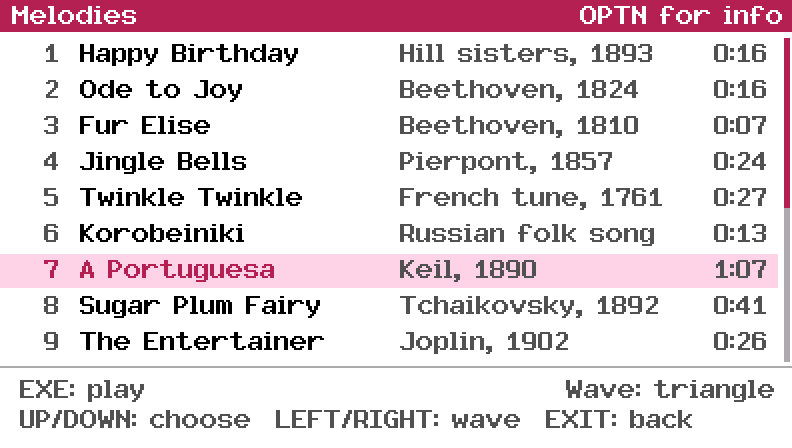
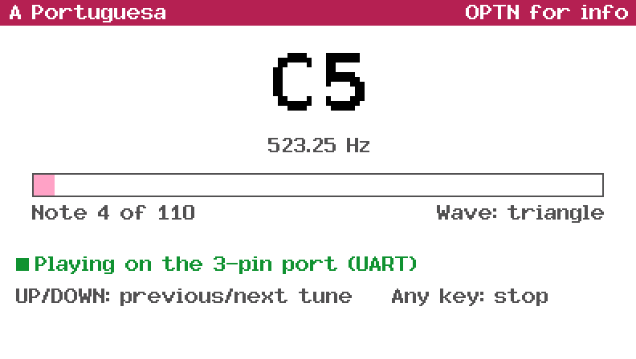
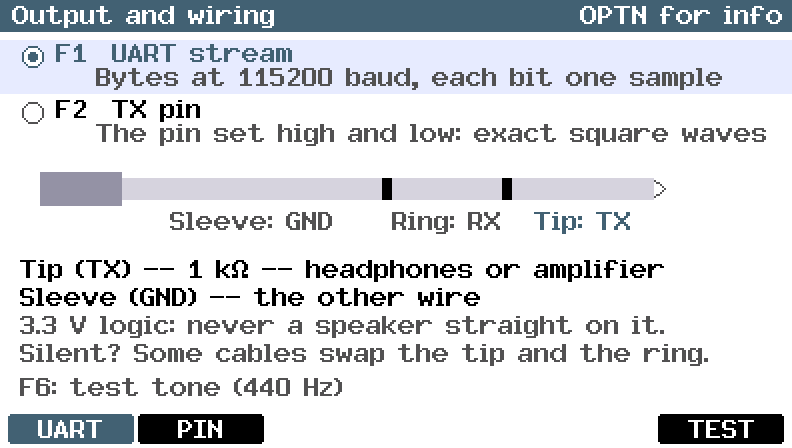
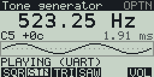
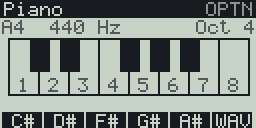
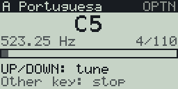

Tone generator for the Casio FX CG 50 (works with the CG10 and 20 too), with a black and white version for the fx-9860G II. Made with fxSDK and gint.

## Download

| Calculator | File |
|---|---|
| fx-CG50, fx-CG10, fx-CG20 (colour) | [Tone.g3a](../../dist/g3a/Tone.g3a) |
| fx-9860G II, fx-9750G II, Graph 35+E II (black and white) | [Tone.g1a](../../dist/g1a/Tone.g1a) |

Copy the file to the root of the calculator's storage over USB (USB Flash mode, F1), then eject it; the app appears in the MENU.

The calculator has no speaker. The sound comes out of the **3-pin link
port** (the 2.5 mm jack on top), so you need a cable to headphones, an
amplifier or a piezo buzzer (see [Wiring](#wiring)). Without one, the app
still shows the waveform, the note and the period of every tone.

The app opens on a menu of five screens.

 

## Tone generator

A steady tone from 20 Hz to 20 kHz, with the nearest note (and how many
cents off it is), the period and the wavelength in air.

| Key | Action |
|---|---|
| EXE | Play / stop |
| UP / DOWN | Frequency up / down by the step |
| LEFT / RIGHT | Bigger / smaller step: 0.1, 1, 10, 100 or 1000 Hz |
| + / − | One semitone up / down |
| 0–9, `.` | Type a frequency, then EXE (EXIT cancels) |
| F1–F4 | Square, sine, triangle, sawtooth |
| F5 | Duty cycle of the square wave: 50, 25 or 10% |
| F6 | Volume: 100, 50 or 25% |

The tone keeps playing while you change it. It stops when you leave the screen.

## Piano

Hold a key to play a note; it stops when you let go.

| Key | Notes |
|---|---|
| 1–8 | The white keys, C to C |
| F1–F5 | The black keys: C#, D#, F#, G#, A# |
| UP / DOWN | Octave up / down (C1 to C8) |
| F6 | Waveform |

The last note played stays on the screen with its frequency.

## Sweep

Glides from one frequency to another. That's useful for finding the
resonance of a speaker, a filter or a glass. F1 sets the start and end
frequencies, the time, the scale (linear, or logarithmic so that each octave
takes the same time) and what happens at the end: stop, repeat, or go back
down. EXE starts and stops it, and F6 changes the waveform.

 

## Melodies

Seventeen tunes, each with who wrote it and how long it lasts. UP/DOWN
chooses one and EXE plays it. They use the tone generator's waveform, duty
cycle and volume; LEFT/RIGHT changes the waveform here.

| # | Tune |
|---|---|
| 1 | Happy Birthday |
| 2 | Ode to Joy (Beethoven) |
| 3 | Für Elise (Beethoven) |
| 4 | Jingle Bells |
| 5 | Twinkle Twinkle Little Star |
| 6 | Korobeiniki (the Tetris tune) |
| 7 | A Portuguesa, the Portuguese anthem (official 1957 version) |
| 8 | Dance of the Sugar Plum Fairy (Tchaikovsky, The Nutcracker) |
| 9 | The Entertainer (Joplin): the introduction and the first strain |
| 10 | In the Hall of the Mountain King (Grieg), three times, faster each time |
| 11 | Beethoven's 5th: the opening |
| 12 | William Tell Overture (Rossini): the galop |
| 13 | Can-Can (Offenbach) |
| 14 | Wedding March (Mendelssohn): the fanfare and the theme |
| 15 | Swan Lake (Tchaikovsky): the oboe's theme |
| 16 | We Wish You a Merry Christmas |
| 17 | La Marseillaise |

While a tune plays, the screen shows each note, its frequency and how far
into the tune it is. UP/DOWN skips to the previous or next tune, and any
other key stops.

 

## Output and wiring

F1 and F2 choose how the tone gets to the port, and F6 plays a 440 Hz test
tone.

| | UART stream (F1, default) | TX pin (F2) |
|---|---|---|
| How | Bytes go out at 115200 baud; every bit, start and stop bits included, is one sample of a 1-bit delta-sigma signal | The TX pin is set high and low directly (the SCIF's SCSPTR register), from a timer |
| Square wave | Edges on the 8.7 µs bit grid | Exact edges, timed to a fraction of a µs (0.14 µs on the fx-CG50) |
| Sine, triangle, saw | 115 200 samples/s | 40 000 samples/s |
| Volume | All waveforms | Not for the square wave (always full) |

Both methods open the port with the OS's `Serial_Open` first, which powers
the serial module and connects its pins. The UART method then only writes
bytes, so it works wherever the OS serial driver does. The pin method uses
a register that gint doesn't describe for this chip (it's the SH7730's
serial port register). If it stays silent on your model, use UART.

### Wiring

| Plug | Signal |
|---|---|
| Tip | TX: the sound |
| Ring | RX (not used) |
| Sleeve | GND |

- **Headphones**: tip → 1 kΩ resistor → headphone input, sleeve → headphone
  ground. A 10 nF capacitor from the input to ground smooths the
  sine, triangle and saw waves.
- **Amplifier or active speakers**: the same, into the line input.
- **Piezo buzzer**: straight between tip and sleeve.

TX is a 3.3 V logic pin that can only give a few milliamps: never connect a
speaker straight to it. The tip carries TX on most references, but Casio
doesn't document the jack, and some link cables are crossed. If you hear
nothing, try the ring.

Older fx-9860G models with an SH3 processor have a different serial
module. The app says so and plays nothing there.

OPTN opens the info screen and EXIT goes back (from the menu, it quits).

## fx-9860G

`Tone.g1a` is the same app on the 128x64 black-and-white fx-9860G II
(4 grey shades). The keys are the same; what differs:

- The F-keys read SQR, SIN, TRI, SAW, the duty cycle (`50%`) and VOL.
- The tone screen shows the frequency in the big font, the note and the
  period on one line, and a small waveform. There is no wavelength line,
  and the step shows as `+-10`.
- The piano's black keys are too small for labels, so the F-key bar names
  the note each of F1–F5 plays (C#, D#, F#, G#, A#), and the key held is
  shown selected. The top line shows the last note and the octave.
- The sweep shows the range as `100 > 10k`, and its settings form shows two
  fields at a time.
- The output screen is text only: the method, the pins and the wiring in
  brief.
- The Melodies list shows five tunes at a time, without the composer and
  length. While one plays, the screen shows the note, its frequency and a
  progress bar.

 

 

© José Rodrigues 2026
